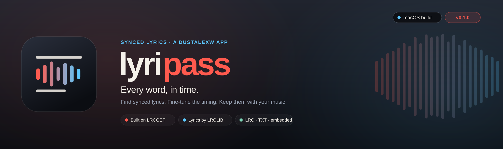
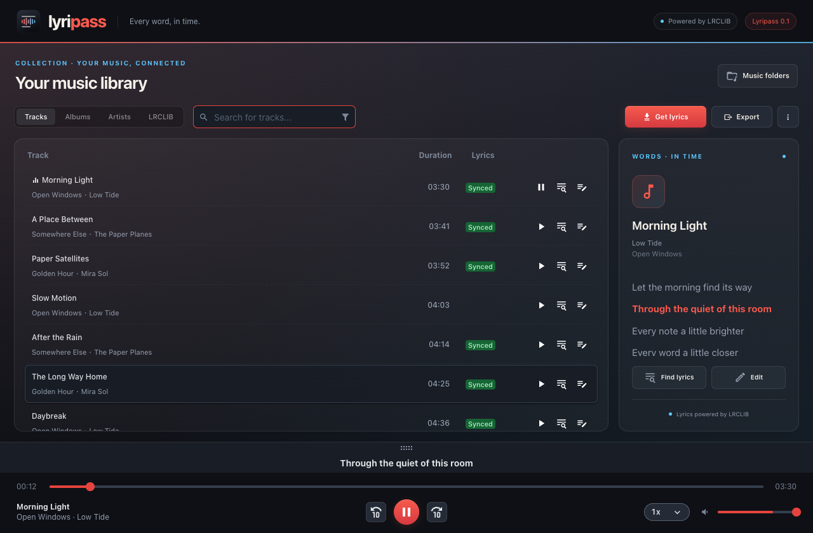

<p align="center"></p>

<p align="center">
  <a href="package.json"></a>
  <a href="#build-it-on-your-mac"></a>
  <a href="LICENSE"></a>
</p>

<p align="center">
  <a href="#bring-your-collection"><b>Bring your collection</b></a>
  &nbsp;·&nbsp;
  <a href="#build-it-on-your-mac"><b>Build the Mac app</b></a>
  &nbsp;·&nbsp;
  <a href="#how-it-works"><b>Under the hood</b></a>
</p>

# lyripass

Your collection has the music. **lyripass** brings the words.

Built on **[LRCGET](https://github.com/tranxuanthang/lrcget)**, lyripass finds synced lyrics for your local
music library through **[LRCLIB](https://lrclib.net)**. Browse your tracks, follow the words as they play,
fine-tune a line or a single word, and export the lyrics beside your music. All in a graphite listening
room with coral controls, sky-blue details, and light and dark appearances.

```text
Bring your music → Find the words → Get the timing right → Take the lyrics with you
```

* **Your collection, connected.** Add local music folders or mounted NAS folders. Browse by track, album,
  or artist, with shared search and incremental scanning.
* **A whole library of lyrics.** Find lyrics for all tracks, only those without synced lyrics, or only
  those with no lyrics at all. Search for a different match on any individual track.
* **Every word, in time.** Follow lyrics during playback. Click a line in the lyrics panel to jump to
  that moment in the song.
* **Get the timing right.** Edit plain lyrics, sync lines, and fine-tune individual word boundaries in
  the lyrics editor. Slow playback down when the vocals move fast.
* **Keep the lyrics with your music.** Export synced `.lrc` files or plain `.txt` files. Experimental
  embedding into supported MP3 and FLAC files is available in Settings.
* **You choose when to export.** Downloaded lyrics live in lyripass’s internal library. Save them to
  your music folders when you want, or enable automatic export for bulk downloads.

Choose **Library options → About** for the app version and links to LRCGET and LRCLIB.

<p align="center"></p>
<p align="center"><sub>Preview with sample tracks and original example lyrics.</sub></p>

## Bring your collection

1. Open **Lyripass.app**, add your music folders, and choose **Open my library**. For a NAS, mount the
   share in Finder first, then select its music folder.
2. Choose **Get lyrics** and select which tracks to match. Use a track’s **Find lyrics** action to
   search for a match yourself.
3. Play a track to follow its lyrics in the side panel. Choose **Edit** to adjust the words or timings.
4. Choose **Export** when you want lyric files saved in your music folders. Automatic export is optional.

lyripass has its own library database. If you already use LRCGET, add your music folders in lyripass to
scan them into the new library; your existing LRCGET database is kept separately.

## Build it on your Mac

The current build has been checked on **Apple silicon**. There is no published download in this
repository yet; packaged builds will appear on the [Releases page](https://github.com/dustalexw/lyripass/releases).

To build, install **Node.js**, **Rust**, and Apple’s **Xcode Command Line Tools**, following the
[Tauri prerequisites](https://v2.tauri.app/start/prerequisites/) for your system. Then:

```sh
git clone https://github.com/dustalexw/lyripass.git
cd lyripass
npm ci
npm run tauri build -- --bundles app
```

Your app is at **`src-tauri/target/release/bundle/macos/Lyripass.app`**. Open it there or copy it to
Applications. The bundle is signed locally, but it is not notarized by Apple. If macOS blocks a build
you trust, use **System Settings → Privacy & Security → Open Anyway**.

The source retains LRCGET’s Windows and Linux support. Those platforms, and Intel Mac builds, have not
yet been verified for this redesign.

## How it works

lyripass keeps LRCGET’s Vue 3 interface and Tauri 2 desktop engine. The Rust backend scans your music
folders, reads track metadata, and keeps the library in SQLite. Lyrics are matched through LRCLIB and
stored internally in the open Lyricsfile format, which supports line and word timings.

The player, scanner, matching, editor, publishing tools, and export queues come from LRCGET. lyripass
adds its own identity and icon, a new folder setup, a compact library workspace, and a persistent lyrics
panel, with a visual style inspired by the other dustalexw apps.

Your audio stays on your computer or mounted drive. Lyrics lookup sends track information to the
configured LRCLIB service. Export is the step that writes lyric files or embedded tags to your collection.

## Work on it

After installing the dependencies, start the desktop development window:

```sh
npm run tauri dev
```

The desktop window provides filesystem access and audio playback; `npm run dev` alone starts only the
web interface.

```sh
npm test            # Frontend checks
npm run lint        # Code checks
npm run build       # Build the web interface
```

The redesign passed **142 frontend tests**. See [VALIDATION.md](VALIDATION.md) for the build checks,
visual checks, and remaining verification limits. Architecture notes live in
[src/ARCHITECTURE.md](src/ARCHITECTURE.md) and [src-tauri/ARCHITECTURE.md](src-tauri/ARCHITECTURE.md).

Regenerate the README header and badges with `python3 scripts/make_readme_assets.py`. The script uses
Python’s standard library and reads the version from `package.json`.

## Credits and licence

lyripass is a fork of **LRCGET**, © Thang Tran and contributors, released under the
[MIT licence](LICENSE). The original README is preserved in [UPSTREAM.md](UPSTREAM.md), and the upstream
Git history is retained.

Lyrics come from **[LRCLIB](https://lrclib.net)**. lyripass is an independent fork and is not the official
LRCLIB client. The interface takes visual cues from [frickoss](https://github.com/dustalexw/frickoss) and
the other dustalexw apps; the lyripass icon and README artwork are included in this repository.
